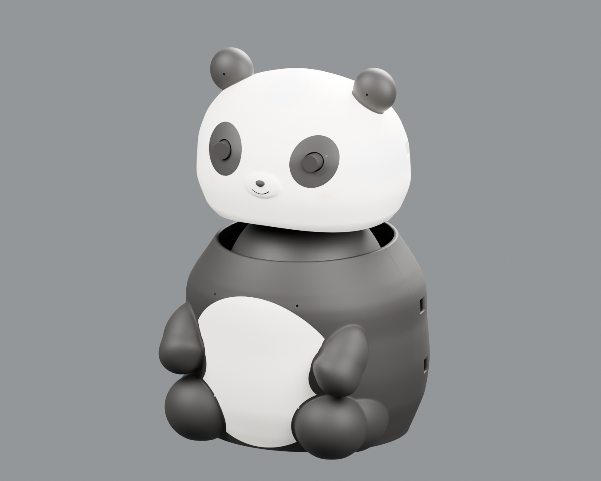
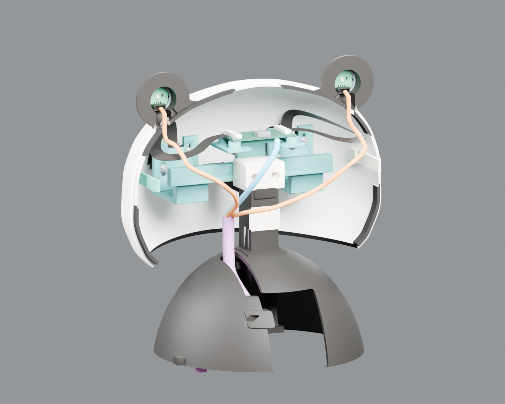
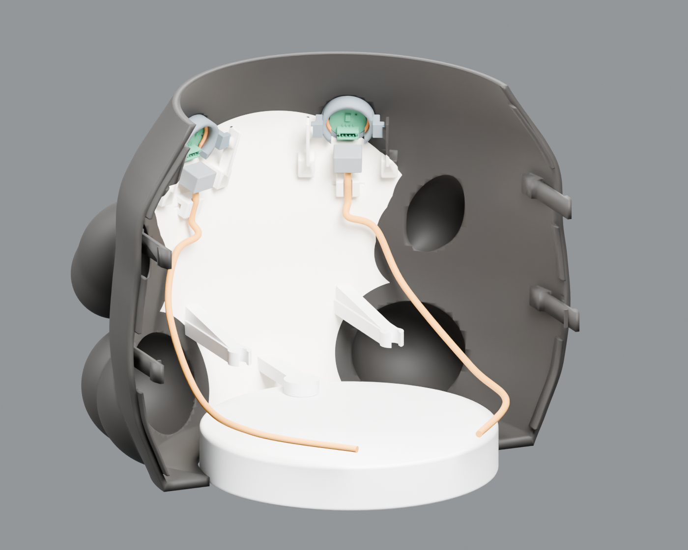
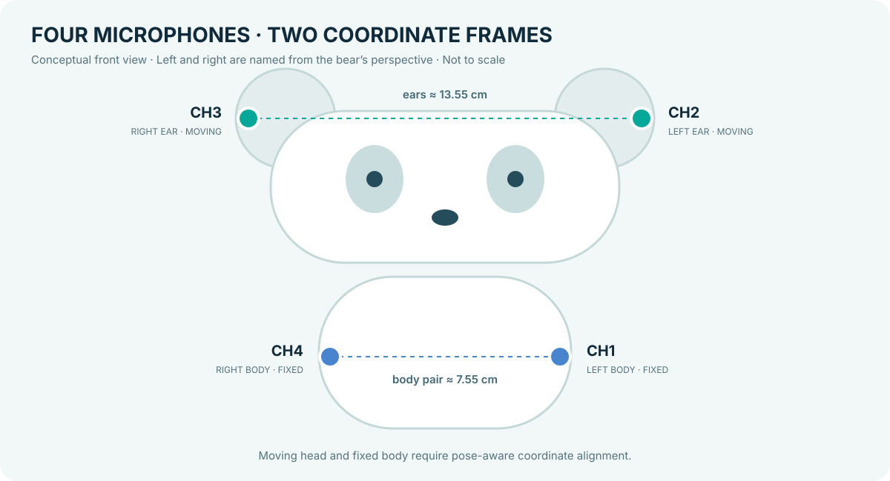
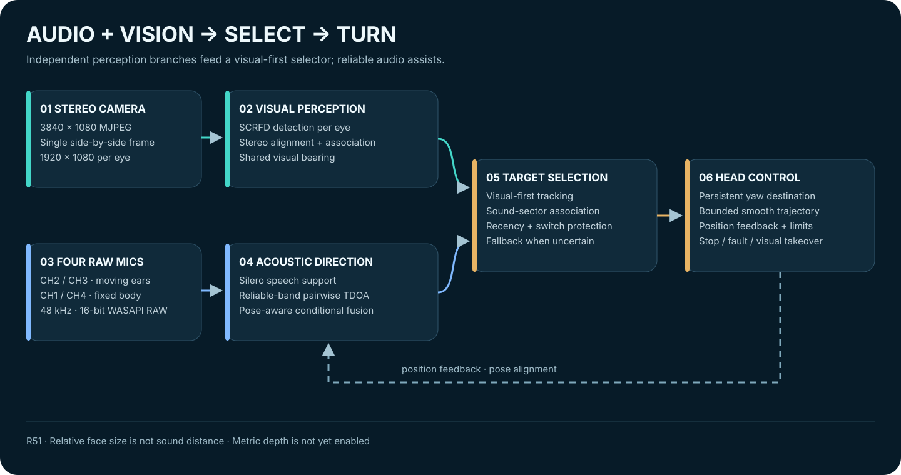

# 深瞳计划 · DeepSight-3D

**让小熊看见人、听见方向，并自然地转向交流。**

双目视觉 · 四麦声源定位 · 视听目标选择 · 双轴平滑控制

[English](README_EN.md) · [快速开始](#快速开始) · [算法架构](#算法架构) · [硬件与结构](#硬件与结构) · [验证与边界](#验证与边界)

[阶段汇报（HTML）](docs/report/index.html) · [整体评估与待处理问题（HTML）](docs/report/assessment.html)

[双人对话录制](docs/DEMO_RECORDING_CN.md) · [一分钟内英文对话稿](docs/DEMO_DIALOGUE_EN.md)

GitHub 文件页默认显示 HTML 源码；克隆或下载仓库后，用浏览器打开以上文件即可离线阅读公开脱敏版。

由仓库 V17 头部和 V25 身体模型按文件坐标组合渲染；这是设计预览，不代表新的装配公差或碰撞验收。

## 项目简介

深瞳计划是一个面向**视听觉选择性感知与交互**的熊猫形机器人研究原型。系统从双目摄像头获取人脸与画面方向，从四路硅麦中估计语音活动和水平声源方向，通过互斥的“听声主导”或“视觉主导”模式选择目标，再通过两轴舵机平滑地转向和跟随。

- **看见**：两眼分别检测人脸，结合双目对齐、跨目关联和共享注视方向。
- **听见**：双耳与身体麦克风独立估计时差，结合人声支持、频段可靠性与姿态进行有条件融合。
- **选择**：听声模式由可靠声音决定方位、视觉修正对应人脸，新声源可打断；视觉模式保持可信视觉目标，声音辅助选人。
- **转向**：保留有限的听声目标，用受限轨迹逐步接近，并在停止、视觉接管或反馈故障时撤销动作权限。

> **R52 更新：** [听声／视觉双优先模式](docs/report/primary-modes-r52.html)已实现，904项Python回归及123项前端检查通过；本机已正常重启核对加载，实机两人交替说话效果待现场复核。两种主模式互斥，采集和平滑轨迹参数不变。

> **此前状态：R51 室内演示候选 / 研究原型。** 项目组反馈现有整体体验可用；R51增加了本机网页来源保护与仓库移植修复，并通过模拟回归。精确声源角度、动态四麦全姿态、多人和正式测距仍需现场验收，不能把模拟测试数量当作实物准确率。

## 硬件与结构

### 模型预览

<table>
<tr><th>头部内部 · 隐藏后壳</th><th>身体内部 · 隐藏后壳</th></tr>
<tr><td></td><td></td></tr>
</table>

这些图根据下列仓库模型渲染：为展示内部结构，临时隐藏了相应后壳并显示文件中已有的线束。此后模型只清理了历史电脑路径，几何和对象结构经复核未变。项目组提供的[耳部麦克风座细节参考图](docs/assets/microphone-holder-reference.png)可用于理解装配关系，其与具体 CAD 修订的对应关系尚未再次核对。

| 结构 | 可编辑源文件 | 说明 |
| --- | --- | --- |
| 头部 V17 | [panda_head_only_V17.blend](hardware/cad/head_shell/panda_head_only_V17.blend) | 包含头壳、耳部、相机固定件和参考器件 |
| 身体 V25 | [panda_body_V25_shells_V16_cylinder.blend](hardware/cad/body_shell/panda_body_V25_shells_V16_cylinder.blend) | 包含身体壳体、身体麦克风座与圆柱底座参考 |
| 来源与校验 | [panda_source_manifest.json](hardware/cad/panda_source_manifest.json) | 记录文件哈希和此前 Blender 读取检查 |

仓库目前提供 `.blend` 可编辑源文件，**尚未包含与这两份模型对应确认的最终 STL / 3MF 或切片文件**。实际打印前需核对导出对象、尺寸、装配公差与线缆避让。[硬件归档说明](hardware/cad/README.md)

### 设备配置

| 部件 | 当前选型或配置 | 说明 |
| --- | --- | --- |
| 双目相机 | SC233HGS，彩色全局快门，商家标称200万像素、112°镜头 | MF手动调焦；112°对应的水平/垂直/对角定义待确认，软件清晰度辅助不是光学自动对焦 |
| 双目数据 | MJPEG 同屏 **3840×1080**，每眼1920×1080，请求60 fps | 历史记录实收约33–50 fps；请求值不是稳定实测值，同帧同屏也不等于已验证同步曝光误差 |
| 麦克风 | YDPI4MIC，四路模拟硅麦，WASAPI RAW，48 kHz / 16 bit | USB音频 VID:PID `EF09:459D`；原始四通道保留 |
| 空间布局 | 耳部约13.55 cm，身体两麦约7.55 cm；同侧耳—身体约17.7–17.8 cm | 来自实物测量/估计，不是完整三维声学阵列标定 |
| 两轴舵机 | Yaw ID 0：1500 / 2000 / 2500；Pitch ID 2：1255 / 1550 / 1855 | 2026-11-04 的**软件位置刻度**：下限 / 控制中位 / 上限；机械边界仍须现场确认 |
| 转角比例 | 用户提供规格：2000 / 270 ≈ **7.4074 刻度/度** | R50起用于听声目标和头身偏航换算；不是最终装配实测角度精度 |
| 控制与网页 | Python、FastAPI、本机网页、50 Hz 平滑轨迹 | 50 Hz 是轨迹下发频率，并非50 Hz位置反馈闭环 |

图中左右以**小熊自身**为准：左耳 CH2、右耳 CH3；身体左 CH1、身体右 CH4。两耳随头转动，身体两麦固定，因此两个坐标系需要随姿态对应。[当前配置示例](configs/panda-assembled-r52.example.json) · [麦克风布局](calibration/microphone_layout.json)

控制中位和声学几何零位是不同的参数：当前示例的水平控制中位为 2000，头部相对身体的声学参考仍沿用 1952。若头身实际装配关系已改变，应重新确认声学参考，不应直接把两者视为相同。

## 算法架构

### 视觉：两眼共同提供跟随方向

1. 采集双目同帧画面并拆分左右画面；每眼独立做人脸检测与多尺度搜索。
2. 使用最终装配后的对齐预览参数，检查两眼对应关系；可信匹配共同估计目标方向，匹配不可靠时不强行合并。
3. 共享跟随方向映射回两眼各自的准星。正常的**水平视差会保留**，不会为了让图像重合而伪造深度。

现有配置输出共同有效画面约 **1837×1053 / 眼**；一次留出与新抓图的垂直对齐验证有改善，但手持纸面、全视野与已知距离精度仍需进一步验证。正式米制距离输出关闭。[双目对齐参数](calibration/stereo_camera-alignment.json) · [双目说明](docs/BINOCULAR_UPGRADE_CN.md)

### 听觉：四路参与，两对有条件融合

四通道原始 PCM 分别进入耳部对和身体对。系统使用预训练 **Silero VAD** 获取人声支持，以频段可靠性加权的 GCC 时差与竞争峰、时间连续性判断形成方向；不会把混合后的音频当作原始相位信息。R49加入了受限的语音状态恢复分支，并未重新训练模型。

身体声源方向只有在姿态和质量条件满足时才转换到头部坐标并参与融合；当反馈不可靠或俯仰偏离当前水平模型范围时，退回可信的耳部方向。它是**两对麦克风的动态协同**，不是已完成全三维标定的六对阵列，也不能可靠输出声音距离或完全消除前后歧义。[四麦设计](docs/FOUR_MIC_FUSION_CN.md) · [动态坐标变换](docs/DYNAMIC_MIC_FUSION_CN.md)

### 视听选择与运动

- **视觉优先**：没有可靠声音或声视冲突时，继续保持可信的可见目标；没有既定目标时参考相对人脸大小和检测质量。
- **声音辅助**：将可信声音区间与整张人脸的角度范围匹配，再结合相对大小、视觉质量和连续性排序。该分数是规则匹配度，不是经过标定的说话人概率。
- **有限目标**：声音短暂停止后，已授权的有限目标可以继续完成；历史蓝色显示不会变成新的声源证据。
- **受限控制**：R50起使用配置的物理刻度/角度比例建立目标，单段步幅和50 Hz轨迹独立限制。位置反馈无效时停止；实际机械转角和顺滑度仍需实物复验。

系统目前不包含声纹/姓名识别、语音转文字或语义对话；相对人脸大小也不是声源距离测量。[视听选择说明](docs/VISUAL_PRIORITY_CN.md) · [听声目标几何](docs/CORE_YAW_GEOMETRY_CN.md)

## 快速开始

以下以 Windows PowerShell 与 Python 3.11 为例。需要 FFmpeg（含 DirectShow）、Node.js（仅前端测试需要）和可用的音视频/串口驱动。依赖与 GPU 环境仍需按目标机器验证。

~~~powershell
git clone https://github.com/CatLiZi/DeepSight-3D.git
Set-Location DeepSight-3D
python -m venv .venv
.\.venv\Scripts\Activate.ps1
python -m pip install -r requirements.txt
~~~

真实硬件采用当前装配配置时，**只在没有现有配置的首次安装**复制示例，再核对设备、方向与安全行程：

~~~powershell
if (-not (Test-Path .\locator_demo_settings.json)) {
    Copy-Item .\configs\panda-assembled-r52.example.json .\locator_demo_settings.json
}
$env:LOCATOR_DEMO_SIM = "0"
python -X utf8 .\run_server.py
~~~

示例默认关闭相机、声音和视觉开关；先在网页核对设备与反馈，再由操作者打开所需功能。串口会因电脑重新分配；可使用网页的只读搜索并确认结果。访问 [http://127.0.0.1:8010/](http://127.0.0.1:8010/)；先不要急于开启自动转头。停止服务时在启动终端按 `Ctrl+C`。

无实体设备的模拟模式：

~~~powershell
$env:LOCATOR_DEMO_SIM = "1"
python -X utf8 .\run_server.py
~~~

程序默认只监听 `127.0.0.1`。R51拒绝外部网页的跨来源控制请求；**这不是本机进程身份认证**，请勿将控制服务直接暴露到局域网或公网。GPU 环境不兼容时需按目标机器选择合适的 ONNX Runtime / PyTorch 版本。[当前运行说明](docs/CURRENT_RELEASE_CN.md)

## 验证与边界

在本机现有 Python 环境、模拟执行器下：

~~~powershell
python -X utf8 tools\validate_regression_repair.py --output .tmp\release-tests
python -X utf8 tools\validate_frontend.py
python -X utf8 tools\validate_geometry_holdout.py
python -X utf8 tools\validate_publication.py --output .tmp\publication-check
~~~

| 证据 | 当前结果 / 状态 |
| --- | --- |
| Python 回归 | **855项通过**；包含跨来源请求、配置移植、双目文件路径、声源目标和运动保护检查 |
| 前端检查 | **104项通过**，包括5项 JavaScript 语法检查 |
| 角度几何模拟 | R50针对不同起始位置、方向和档位的240组独立模拟通过；未驱动舵机 |
| 真实声音 | 既有录音回放显示连续性改善；轻声、转动噪声、多人及远距离尚缺完整现场验收 |
| 当前双目 | 对齐预览已应用；正式尺度、全视野误差与已知距离精度未验收 |
| 机械 | 用户反馈整体体验可用；偶发位置反馈、最终机械边界与实测顺滑度仍需继续核对 |

测试没有访问实体舵机。实测时如果没有量角工具，先按小熊左／中／右测试转向方向、短句结束后是否继续到位以及停止是否生效；不要把目测站位当成精确的30°/45°真值。[验证记录](docs/VALIDATION_R52.md)

## 项目结构

~~~text
DeepSight-3D/
├── src/locator_demo/       # 采集、听觉、双目、选人与运动控制
├── src/locator_demo/web/   # FastAPI、状态接口、本机控制网页
├── configs/                # 装配配置示例（不覆盖本机设置）
├── calibration/            # 双目对齐预览和麦克风布局
├── hardware/cad/           # 头部/身体 Blender 源文件与模型清单
├── models/                 # 视觉与语音活动预训练模型
├── tests/                  # 合成信号和模拟执行器测试
├── tools/                  # 标定、诊断、测试及图示生成工具
└── docs/                   # 说明、验证记录和项目展示素材
~~~

可选 TalkNet 以 Git submodule 保留，当前装配默认使用 `rules`；要研究可选后端可运行 `git submodule update --init --recursive`，并按其上游说明准备权重。第三方组件与模型受各自许可约束；Silero 许可见 [models/silero_vad.LICENSE.txt](models/silero_vad.LICENSE.txt)。本仓库尚未声明整体项目许可证。
