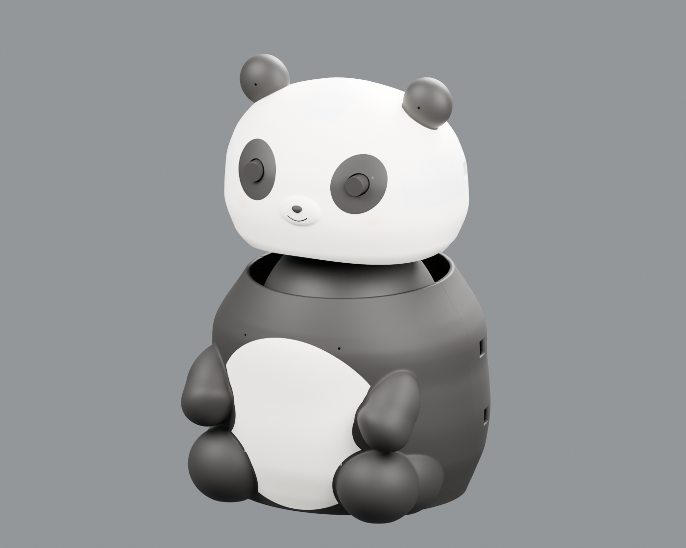
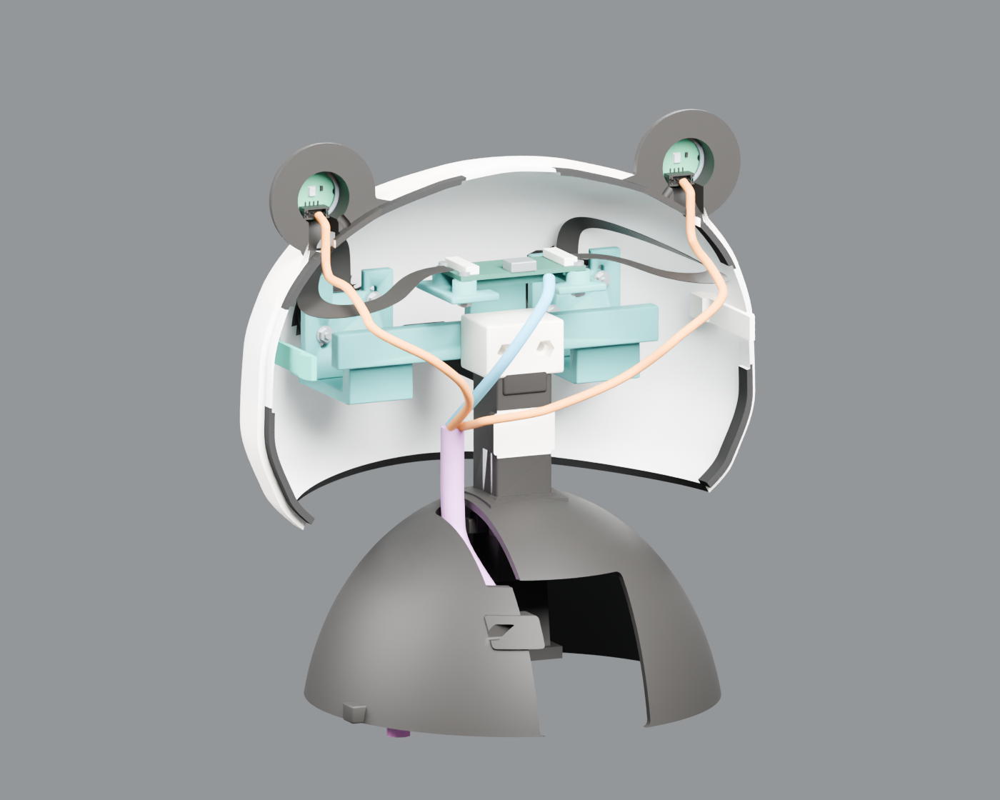
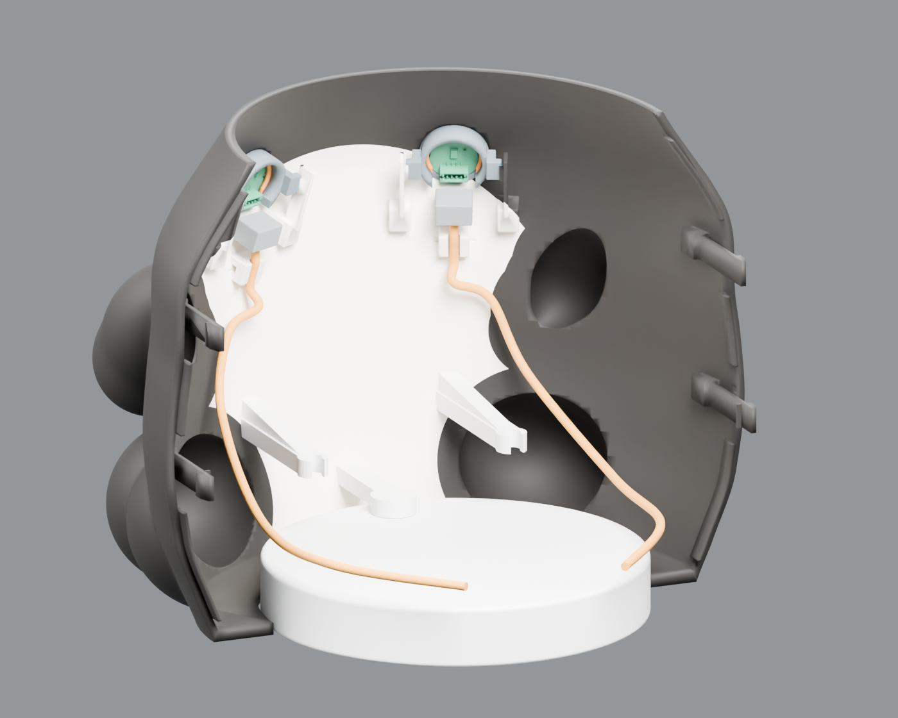
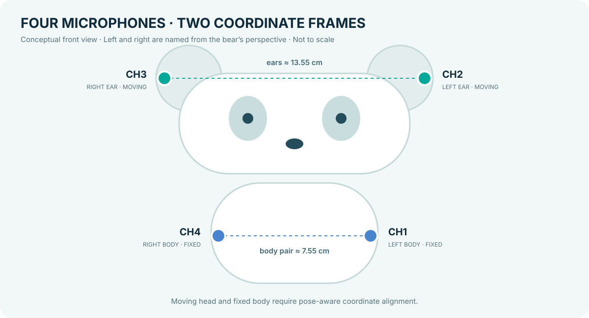
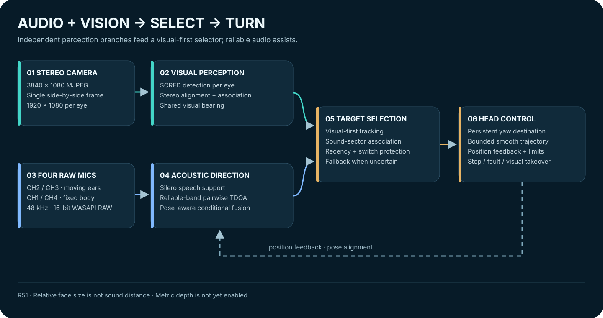

# DeepSight-3D

**A panda that sees people, listens for direction, and turns toward interaction.**

Stereo vision · Four-microphone localization · Audio-visual selection · Smooth two-axis control

[中文](README.md) · [Quick start](#quick-start) · [Architecture](#architecture) · [Hardware and CAD](#hardware-and-cad) · [Validation and limits](#validation-and-limits)

Rendered by combining the V17 head and V25 body at their source-file coordinates. This is a design preview, not a new tolerance or collision certification.

## Overview

DeepSight-3D is a panda-shaped research prototype for **selective audio-visual perception and interaction**. It detects and associates faces from stereo images, estimates speech activity and horizontal sound direction from four microphones, selects a visible target with visual priority, and turns a two-axis head toward that target.

- **See:** detect faces independently in both eyes and associate them using stereo alignment and a shared viewing direction.
- **Listen:** estimate delays from the ear and body pairs, supported by voice activity, frequency reliability, and pose-dependent fusion.
- **Select:** retain a reliable visual target; use a reliable sound sector to nominate a likely visible speaker.
- **Turn:** retain a bounded acoustic destination, approach it with a smooth trajectory, and revoke motion on stop, visual takeover, or feedback fault.

> **Status: R51 indoor-demo candidate / research prototype.** The project team reports that the current overall experience is usable. R51 adds local browser-origin protection and fresh-checkout portability fixes, verified in simulation. Absolute acoustic angle, full-pose four-microphone fusion, multiple speakers, and metric depth still need field acceptance; test counts are not physical accuracy.

## Hardware and CAD

### Model views

<table>
<tr><th>Head interior · rear shell hidden</th><th>Body interior · rear shell hidden</th></tr>
<tr><td></td><td></td></tr>
</table>

The views are rendered from the repository files below. Rear shells are temporarily hidden and existing modeled wiring is shown for inspection; **the source models are not modified or re-saved**. The [ear microphone holder reference](docs/assets/microphone-holder-reference.png) was supplied by the project team; its exact correspondence to a CAD revision has not been independently rechecked.

| Component | Editable source | Contents |
| --- | --- | --- |
| V17 head | [panda_head_only_V17.blend](hardware/cad/head_shell/panda_head_only_V17.blend) | Head shells, ears, camera mounts, and component references |
| V25 body | [panda_body_V25_shells_V16_cylinder.blend](hardware/cad/body_shell/panda_body_V25_shells_V16_cylinder.blend) | Body shells, body microphone holders, and cylinder-base reference |
| Provenance | [panda_source_manifest.json](hardware/cad/panda_source_manifest.json) | File hashes and earlier Blender inspection |

The repository currently contains editable `.blend` sources, **not verified final STL / 3MF exports or slicer projects for this pair of models**. Check export objects, dimensions, fit, and cable clearance before printing. [CAD guide](hardware/cad/README.md)

### Hardware snapshot

| Component | Selection or configuration | Qualification |
| --- | --- | --- |
| Stereo camera | SC233HGS, color global shutter; vendor states 2 MP and 112° lens | Manual focus; the 112° axis is not confirmed. Focus assistance is not optical autofocus |
| Stereo stream | MJPEG side-by-side **3840×1080**, 1920×1080 per eye, 60 fps requested | Historical captures received roughly 33–50 fps; request rate and synchronized exposure error are not verified performance |
| Microphones | YDPI4MIC, four analog MEMS microphones, WASAPI RAW, 48 kHz / 16-bit | USB audio VID:PID `EF09:459D`; all four raw channels are retained |
| Spacing | Ears about 13.55 cm; body pair about 7.55 cm; same-side ear–body about 17.7–17.8 cm | User measurements/estimates, not a complete 3D acoustic calibration |
| Two servo axes | Yaw ID 0: 1404 / 1952 / 2500; Pitch ID 2: 1255 / 1555 / 1855 | Current rig **software position units**, minimum / center / maximum; mechanical limits still require field confirmation |
| Servo angle scale | User-provided specification: 2000 / 270 ≈ **7.4074 ticks/degree** | Used for acoustic goals and head/body yaw conversion since R50; not a measured assembled-rig angle calibration |
| Control and UI | Python, FastAPI, local dashboard, 50 Hz smooth trajectory | 50 Hz is command-trajectory frequency, not 50 Hz physical position feedback |

Left and right are the **bear’s own**: left ear CH2, right ear CH3; left body CH1, right body CH4. The ears move with the head while the body pair remains fixed, so the two coordinate frames must be aligned with pose. [Rig example](configs/panda-assembled-r51.example.json) · [Microphone layout](calibration/microphone_layout.json)

## Architecture

### Vision: both eyes contribute to the viewing direction

1. Capture a side-by-side stereo frame and detect faces independently in each eye, with multi-scale search.
2. Apply the final-assembly alignment-preview parameters and associate corresponding observations; do not forcibly merge ambiguous pairs.
3. Map a shared steering direction back to each eye. Real **horizontal disparity is retained**; depth is not fabricated to make two previews overlap.

The current common view is approximately **1837×1053 per eye**. Held-out and new board frames showed lower vertical alignment error, but hand-held board flatness, full-field accuracy, and known-distance accuracy still need validation. Metric distance output remains disabled. [Stereo profile](calibration/stereo_camera-alignment.json) · [Stereo notes](docs/BINOCULAR_UPGRADE_CN.md)

### Audio: four channels, two conditionally fused pairs

Raw PCM is processed as an ear pair and a body pair. A pre-trained **Silero VAD** supplies speech support; reliability-weighted GCC delay estimates, competing-peak checks, and temporal consistency produce the bearing. Processed/mixed audio is not substituted for the raw phase. R49 added a bounded speech-state recovery branch without retraining the model.

A body bearing is transformed into head coordinates only when pose and acoustic quality support it; otherwise the system falls back to a reliable ear bearing. This is **pose-aware cooperation between two microphone pairs**, not a fully calibrated six-pair 3D array. It cannot reliably measure sound distance or fully resolve front/back ambiguity. [Four-mic design](docs/FOUR_MIC_FUSION_CN.md) · [Pose alignment](docs/DYNAMIC_MIC_FUSION_CN.md)

### Selection and motion

- **Visual priority:** preserve a trustworthy visible target when sound is absent or conflicts with the scene; apparent face size is only a relative cue.
- **Audio guidance:** compare a reliable sound sector with the whole angular extent of each face, then rank using relative size, visual quality, and continuity. The score is a rule-based association score, not a calibrated speaker probability.
- **Finite target:** a short pause in speech need not erase an authorized destination; a historical blue overlay is not new acoustic evidence.
- **Bounded control:** R50+ converts a bearing with the configured ticks/degree scale while separately limiting each step and the 50 Hz trajectory. Invalid position feedback stops motion; actual mechanical accuracy and smoothness still require field validation.

The system does not currently identify names or voiceprints, transcribe speech, or provide semantic dialogue. Face size is not an acoustic range estimate. [Visual-priority design](docs/VISUAL_PRIORITY_CN.md) · [Acoustic goal geometry](docs/CORE_YAW_GEOMETRY_CN.md)

## Quick start

The example uses Windows PowerShell and Python 3.11. FFmpeg with DirectShow, suitable audio/video and serial drivers, and Node.js for frontend tests are required. Verify dependencies and GPU support on the target machine.

~~~powershell
git clone https://github.com/CatLiZi/DeepSight-3D.git
Set-Location DeepSight-3D
python -m venv .venv
.\.venv\Scripts\Activate.ps1
python -m pip install -r requirements.txt
~~~

For this assembled rig, copy the example **only on first installation when no local settings file exists**, then verify devices, directions, and safe travel:

~~~powershell
if (-not (Test-Path .\locator_demo_settings.json)) {
    Copy-Item .\configs\panda-assembled-r51.example.json .\locator_demo_settings.json
}
$env:LOCATOR_DEMO_SIM = "0"
python -X utf8 .\run_server.py
~~~

The example starts with camera, audio, and visual feature switches off. Check devices and feedback in the dashboard before enabling what is needed. Serial port assignments can change; use the read-only discovery and confirm the result. Open [http://127.0.0.1:8010/](http://127.0.0.1:8010/) and check before starting automatic motion. Stop the service with `Ctrl+C` in its terminal.

Simulation without physical devices:

~~~powershell
$env:LOCATOR_DEMO_SIM = "1"
python -X utf8 .\run_server.py
~~~

The service listens on `127.0.0.1` by default. R51 rejects cross-origin browser control requests; **this is not authentication against other local processes**, so do not expose the controller directly to a LAN or the internet. Choose compatible ONNX Runtime / PyTorch builds for the target machine. [Current release notes](docs/CURRENT_RELEASE_CN.md)

## Validation and limits

With the existing local Python environment and simulated actuators:

~~~powershell
python -X utf8 tools\validate_regression_repair.py --output .tmp\release-tests
python -X utf8 tools\validate_frontend.py
python -X utf8 tools\validate_geometry_holdout.py
~~~

| Evidence | Result / status |
| --- | --- |
| Python regression | **855 passed**, including cross-origin, checkout portability, calibration file, acoustic-goal, and motion-safety checks |
| Frontend checks | **104 passed**, including five JavaScript syntax checks |
| Angle-geometry simulation | 240 independent R50 cases across start positions, directions, and speed profiles; no physical motor was driven |
| Real audio | Existing recording replay shows a continuity improvement; soft speech, motor noise, multiple people, and long distance still need comprehensive field acceptance |
| Stereo | Alignment preview is available; metric scale, full-field error, and known-distance accuracy are not accepted |
| Mechanics | The user reports the overall experience is usable; intermittent feedback, final mechanical limits, and measured smoothness remain to be checked |

These tests do not access the physical servos. Without an angle-measurement tool, first check the bear’s left / center / right response, whether a confirmed short utterance completes its turn, and whether Stop cancels remaining motion. Do not treat approximate human positions as exact 30°/45° ground truth. [Validation record](docs/VALIDATION_R51.md)

## Repository layout

~~~text
DeepSight-3D/
├── src/locator_demo/       # capture, audio, stereo, selection and motion
├── src/locator_demo/web/   # FastAPI, state API and local control dashboard
├── configs/                # rig examples; do not overwrite local settings
├── calibration/            # stereo alignment preview and microphone layout
├── hardware/cad/           # head/body Blender sources and model manifest
├── models/                 # pre-trained vision and voice-activity models
├── tests/                  # synthetic signals and simulated actuator checks
├── tools/                  # calibration, diagnostics, tests and diagram tools
└── docs/                   # guides, validation and project visuals
~~~

Optional TalkNet remains a Git submodule; the current rig uses `rules` by default. To explore it, run `git submodule update --init --recursive` and obtain weights according to the upstream instructions. Third-party components and models retain their own licenses; Silero’s license is in [models/silero_vad.LICENSE.txt](models/silero_vad.LICENSE.txt). The repository does not currently declare a project-wide license.
